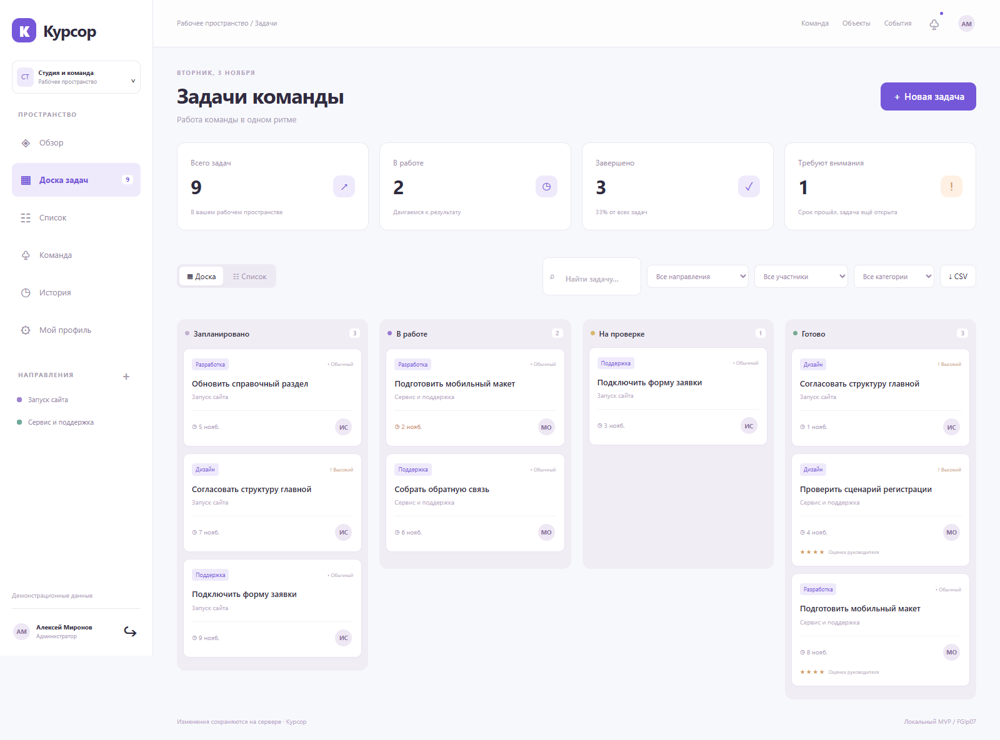
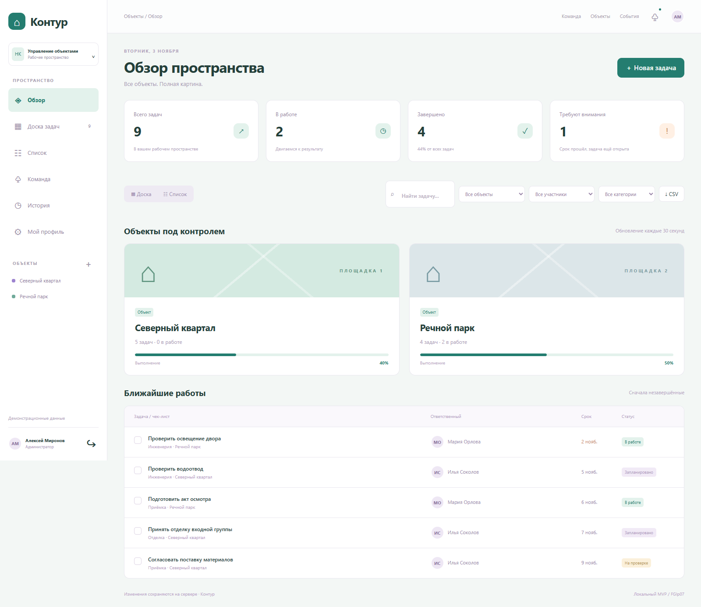
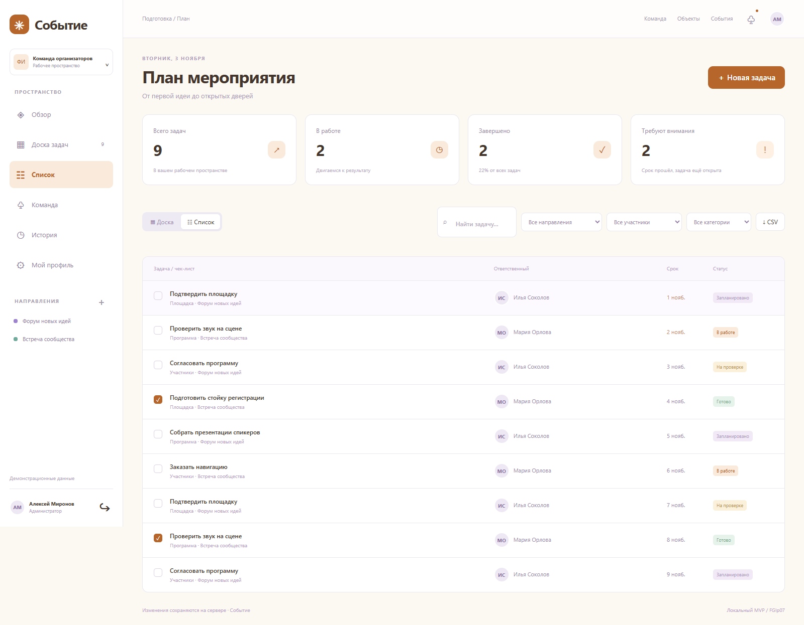

# Zerocoder Trackers

Три учебных трекера на общей платформе: задачи команды, строительные объекты и подготовка мероприятий. Проект показывает, как собрать задачи, ответственных, сроки и обсуждения в одном интерфейсе. Все имена, задачи и объекты в демонстрации вымышлены.

## Для кого и какие задачи решает

| Вариант | Пользователь | Сценарий |
| --- | --- | --- |
| «Курсор» — `/team` | Небольшая команда и руководитель | Распределение задач и просмотр состояния на канбан-доске |
| «Контур» — `/sites` | Координатор строительных работ | Обзор объектов, прогресса и ближайших задач |
| «Событие» — `/event` | Организатор мероприятий | Чек-лист подготовки с ответственными и сроками |

## Экраны проекта

### Задачи команды

Канбан-доска показывает задачи по статусам, исполнителей и сроки.



### Строительные объекты

Обзор объединяет карточки объектов, прогресс и ближайшие работы.



### Подготовка мероприятия

Список помогает следить за подготовкой площадки, программой и другими задачами.



## Возможности

- Вход с ролями администратора, руководителя и сотрудника.
- Создание и изменение задач, назначение исполнителя, срока и приоритета.
- Доска и список задач, поиск и фильтрация.
- Комментарии, история изменений и выгрузка CSV.
- Хранение данных в SQLite между перезапусками.

Сотрудник видит только свои задачи и может менять их статус. Руководитель управляет задачами своего варианта трекера; создание пользователей доступно администратору. Разделение доступа проверяется на сервере.

## Стек

Node.js 24+ со встроенным модулем SQLite; HTML, CSS и JavaScript без клиентского фреймворка. Дополнительных npm-зависимостей нет. Репозиторий содержит Dockerfile и автоматические проверки HTTP/SQLite.

## Локальный запуск

Установите Node.js 24 или новее и скачайте репозиторий. В PowerShell из его корневой папки:

```powershell
$env:DEMO_MODE = '1'
npm start
```

Откройте нужный вариант:

- [Задачи команды](http://127.0.0.1:8797/team)
- [Строительные объекты](http://127.0.0.1:8797/sites)
- [Подготовка мероприятия](http://127.0.0.1:8797/event)

Демонстрационные логины: `admin`, `manager`, `employee`. Учебный пароль показан на экране входа. Демо-режим предназначен для вымышленных данных. Для остановки нажмите Ctrl+C в терминале.

## Проверки

```powershell
npm test
```

Тесты HTTP/SQLite используют временные базы, а не рабочие данные.

## Хранение и развёртывание

По умолчанию база находится в `data/trackers.sqlite`; путь можно задать через `DATA_DIR`. Для контейнера нужен постоянный том `/data`, чтобы данные сохранялись при его пересоздании.

```powershell
docker build -t fgip07-trackers .
```

Для закрытого экземпляра выключите `DEMO_MODE` и до первого запуска на чистой базе задайте `ADMIN_PASSWORD` длиной не менее 12 символов через окружение. Начальные пароли трёх ролей одинаковы: каждый нужно заменить через профиль перед передачей доступа. Рабочую базу, пароли и файлы окружения не публикуйте.

## Границы учебного проекта

Это MVP для демонстрации, а не полное исполнение коммерческих заказов. Нет файловых вложений, реальных email-уведомлений, внешних интеграций и восстановления пароля по email. Сложные права отдельных проектов не реализованы. Обновление данных выполняется периодически, без WebSocket. Готовность к хранению реальных персональных данных и промышленной эксплуатации не заявляется.

Публичное онлайн-демо не указано; интерфейс можно изучить по трём скриншотам или запустить локально.
